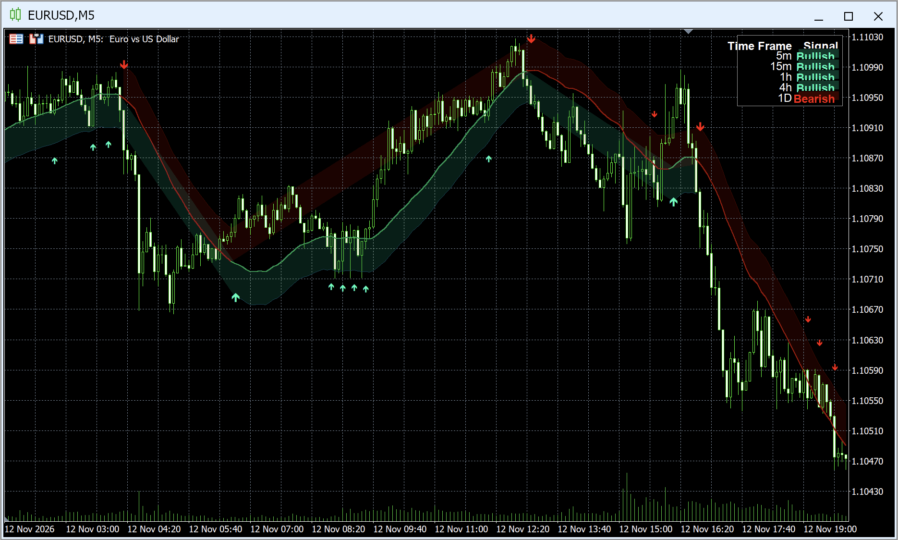

# Open Source Indicators

Open-source custom indicators for MetaTrader 5, written in MQL5.

## Available indicators

| Title | Description | Raw source | Screenshot |
| --- | --- | --- | --- |
| Zero Lag Trend Signals (MTF) | A zero-lag exponential moving average with Wilder ATR deviation bands, bullish and bearish trend reversal and entry signals, a five-timeframe trend dashboard, and configurable popup alerts on closed bars. | [Download MQL5 source](https://raw.githubusercontent.com/trythrow/open-source-indicators/main/zero_lag_trend_signals.mq5) |  |

## Installation

1. Download the indicator's raw `.mq5` source file.
2. In MetaTrader 5, select **File → Open Data Folder** and copy the file into `MQL5/Indicators`.
3. Open the file in MetaEditor and compile it with **F7**.
4. Refresh the **Indicators** list in MetaTrader 5's Navigator and attach the indicator to a chart.

## License and attribution

Distributed under the [Mozilla Public License 2.0](LICENSE).

Zero Lag Trend Signals (MTF) is adapted from AlgoAlpha's original Pine Script indicator. The MQL5 port and adaptation are by Ahmad Said. See the [source file](zero_lag_trend_signals.mq5) for attribution and license notices.
